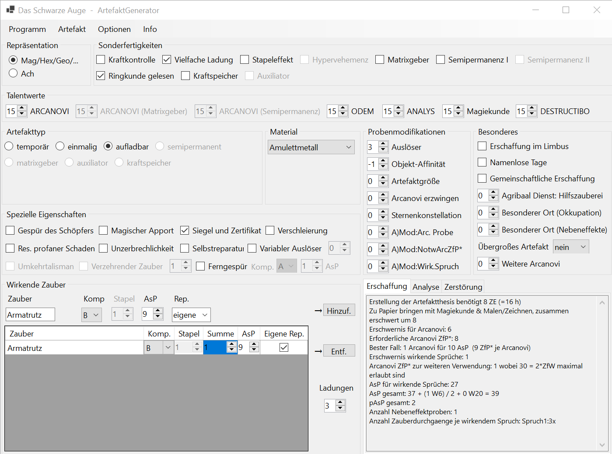

# DSA Artefaktgenerator

Der DSA Artefaktgenerator ist eine .NET 10.0 Windows Desktop Applikation (x64) und versucht die Regeln rund um die Erstellung magischer Artefakte im DSA 4.1 Regelsystem einfach nutzbar zu machen.

## Download

Der Artefaktgenerator findet sich inzwischen auch als PayWhatYouWant zum Download im Scriptorium Aventuris. Wer möchte darf dort auch gerne eine Spende da lassen, muss aber nicht.

https://www.ulisses-ebooks.de/product/507170/DSA-Artefaktgenerator

Der Installer zur aktuellsten Version findet sich jeweils auch hier: https://github.com/pielmach/dsa-artefaktgenerator/releases

Wer die Software selber kompilieren möchte, kann dies mit Visual Studio 2026 in der Community Edition tun. Für den Installer benötigt man noch die kostenlose [Microsoft Visual Studio Installer Projects 2022](https://marketplace.visualstudio.com/items?itemName=VisualStudioClient.MicrosoftVisualStudio2022InstallerProjects) Erweiterung.

## Screenshot

## Abhängigkeiten

Als Laufzeitumgebung wird die .NET 10.0 Desktop Runtime (x64) benötigt. Diese steht kostenfrei unter https://dotnet.microsoft.com/en-us/download/dotnet/10.0/runtime zur Verfügung. Der Installer (``setup.exe``) installiert diese jedoch automatisch.

## Geschichte

Soweit sich den Commit Logs entnehmen lässt hat Mario Rauschenberg zwischen 2009 und 2011 die erste Version des DSA Artefaktgenerators erstellt und sie wurde via dsa-hamburg.de verteilt. Es gab sogar einen eingebauten Updater. Bis 2015 wurde nach und nach neue Versionen veröffentlicht, bis zur letzten offiziellen Version 2.5.0. Danach wurde es ruhig, die Domain dsa-hamburg.de steht schon länger zum Verkauf.

Mario hatte dankenswerter Weise damals den Code auf SourceForge unter der GPL veröffentlicht (https://sourceforge.net/projects/artgen/). Von dort hat Dennis ab 2017 angefangen die Wege der Alchemie Errata (aus reinem Eigennutz wie er zugibt 😉) einzupflegen und einige Bugfixes zu erstellen. Diese wurde teilweise als 2.6.0 Beta Versionen von ihm im dsa-forum.de verteilt.

Im Februar 2022 ist Michael durch Zufall auf die inoffizielle Weiterentwicklung von Dennis gestoßen, und vor allem die Tatsache, dass der Code unter der GPL als Open Source veröffentlicht wurde.

Nach kurzem Kontakt hat Michael beschlossen das Tool auf .NET 6.0 zu aktualisieren, die UI zu überarbeiten und an heutige Bildschirmauflösungen anzupassen. Weiterhin wurden einige Altlasten wie der inwzschen funktionslose Updater entfernt. Der Linux/Mono Support blieb bei all dem leider auf der Strecke. Dafür baut das Tool nun problemlos auch auf anderen Umgebungen als Dennis speziell dafür eingefrorener Virtuellen Maschine.

Die nun entstandene Version 3.0.0 unterstützt hoffentlich die nächste Dekade aller artefaktbegeisterter DSA 4.1 Spieler. Und vielleicht erfährt sie in Zukunft ja auch noch ein wenig Weiterentwicklung.

Eine Dekade war es nicht ganz, da Microsoft den Support für .NET 6.0 auslaufen hat lassen. Daher gibt es nun, kurz vor Ende 2024, die Version 4.0.0 mit .NET 8.0 als Basis und einem neuen PDF Generator, da die alte Bibliothek nicht mehr kompatibel war. Das Layout der PDFs hat sich dadurch leicht geändert, dafür sind die Artefaktladungen nun enthalten. Inhaltlich gibt es aber keine weiteren Veränderungen am Generator. Darüber hinaus wurde das Programm fit gemacht um es im Scriptorium Aventuris einstellen zu können. Durch die Neuauflage des 4.1 Regelwerkes erreicht es so vielleicht ein paar mehr Spieler.

Anfang 2026 folgte die Version 4.1, welche auf .NET 10.0 umstellt und nur noch für die 64-bit Architektur kompiliert wird.

## Danksagung

Danksagungen gelten natürlich vor allem Mario Rauschenberg, der die erste Version damals veröffentlicht hat. Es ist uns auch gelungen ihn zu kontaktieren und auf dieses Repository aufmerksam zu machen.

## Eigene Artefaktmaterialien

TODO: Anleitung für ``material.mod.artgen`` einfügen
